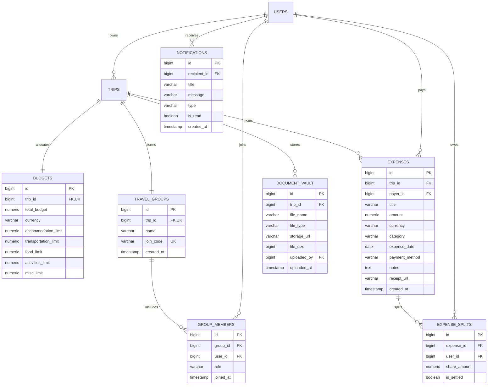

# TripNest — Backend Technical Design Document & Milestone 3 Blueprint (PlanningBkdM3.md)

**Document Version:** 3.0.0 (Milestone 3 — Backend First Edition)  
**Author:** Shreyas (Backend Engineer) & Antigravity (AI Pair Programmer)  
**Project Path:** `TripNestProjVer3M3/code_Backend`  
**Target Database:** PostgreSQL 16 (`tripnestdb2ag` / `tripnestdb3ag`)  
**Scope Reference:** *Task Tracker Travel Management System (2).xlsx* (Team B / M3 Scope)

---

## Executive Summary & Alignment with Mentor's Plan

In accordance with the mentor's evaluation plan, **Milestone 3 is executed Backend-First**. Milestone 2 delivered the core itinerary engine (Trips, Day-by-Day Itineraries, Activities, and Destinations). Milestone 3 equips TripNest with **financial budgeting, expense tracking, collaborative travel groups, debt settlement algorithms, and a secure document vault**.

This document is organized into two primary sections:
1. **Part 1: Evaluator & Stakeholder Overview** — Layman, non-technical explanation for internship presentations and university panels.
2. **Part 2: Technical Design Document (TDD)** — Deep-dive engineering blueprint detailing schemas, DTOs, service algorithms (including Min-Cash-Flow debt simplification), REST contracts, and testing matrices for all **6 M3 Backend Tasks**.

---

# PART 1: EVALUATOR & STAKEHOLDER OVERVIEW

### The Problem We Are Solving in Milestone 3
Vacation logistics often collapse when money and group coordination get complicated:
* Friends argue over *"Who paid for what?"* and lose receipts.
* Travelers exceed their budgets because they have no real-time warning before money runs out.
* Critical documents (flight PDFs, train PNRs, hotel bookings) are scattered across WhatsApp chats and emails.

### How Milestone 3 Solves This (The 6 Features)

```text
┌─────────────────────────────────────────────────────────────────────────────┐
│                       MILESTONE 3 USER JOURNEY                              │
├───────────────────┬───────────────────┬───────────────────┬─────────────────┤
│ 1. SET BUDGET     │ 2. LOG EXPENSES   │ 3. GROUP TRAVEL   │ 4. SETTLE DEBTS │
│ Target limits for │ Track real-time   │ Invite friends by │ One-click math  │
│ Hotel, Food, Cabs │ costs via UPI/Card│ email & join code │ "A pays B ₹500" │
└───────────────────┴───────────────────┴───────────────────┴─────────────────┘
```

1. **Category-Wise Budgeting (Task 1):** Travelers set a total budget (e.g. ₹40,000) and allocate funds across Accommodation, Transport, Dining, Activities, and Miscellaneous.
2. **Real-Time Expense Tracking (Task 2):** Log purchases as they happen with merchant name, amount, date, and payment method (UPI, Card, Cash).
3. **Smart Budget Warning Alerts (Task 3):** If dining spending crosses **85%**, the traveler gets an alert. If it exceeds **100%**, the system warns of overspending.
4. **Group Travel Hub (Task 4):** Invite travel companions using email or a 6-character Join Code (e.g. `GOA-789`), with role control (`ADMIN` vs `MEMBER`).
5. **Fair Expense Splitting & Debt Simplification (Task 5):** When one person pays for dinner, the app calculates everyone's fair share and outputs simple settlement directions (*"Rahul pays Sneha ₹650 to clear all balances"*).
6. **Travel Document Locker (Task 6):** Secure cloud vault for storing flight boarding passes, hotel reservation PDFs, and ticket images directly inside the trip.

---

# PART 2: TECHNICAL DESIGN DOCUMENT (TDD)

```
┌─────────────────────────────────────────────────────────────────────────┐
│                       TRIPNEST M3 ARCHITECTURE                          │
│                      Spring Boot 3.x + Java 21                          │
└────────────────────────────────────┬────────────────────────────────────┘
                                     │
         ┌───────────────────────────┼───────────────────────────┐
         ▼                           ▼                           ▼
┌──────────────────┐       ┌──────────────────┐       ┌──────────────────┐
│ Finance Engine   │       │ Collaboration    │       │ Media & Storage  │
│ - Budget Entity  │       │ - TravelGroup    │       │ - DocumentVault  │
│ - Expense Entity │       │ - GroupMember    │       │ - Multi-part I/O │
│ - Min-Cash-Flow  │       │ - Invite Codes   │       │ - Notifications  │
└──────────────────┘       └──────────────────┘       └──────────────────┘
```

---

## 1. Complete Relational Database Schema & DDL

The database model extends the existing `users` and `trips` tables with 6 new normalized tables:



### PostgreSQL DDL Specifications

```sql
-- =========================================================================
-- 1. BUDGETS TABLE (Task 1)
-- =========================================================================
CREATE TABLE IF NOT EXISTS budgets (
    id BIGSERIAL PRIMARY KEY,
    trip_id BIGINT NOT NULL UNIQUE REFERENCES trips(id) ON DELETE CASCADE,
    total_budget NUMERIC(12, 2) NOT NULL CHECK (total_budget >= 0),
    currency VARCHAR(10) NOT NULL DEFAULT 'INR',
    accommodation_limit NUMERIC(12, 2) DEFAULT 0.00 CHECK (accommodation_limit >= 0),
    transportation_limit NUMERIC(12, 2) DEFAULT 0.00 CHECK (transportation_limit >= 0),
    food_limit NUMERIC(12, 2) DEFAULT 0.00 CHECK (food_limit >= 0),
    activities_limit NUMERIC(12, 2) DEFAULT 0.00 CHECK (activities_limit >= 0),
    misc_limit NUMERIC(12, 2) DEFAULT 0.00 CHECK (misc_limit >= 0),
    created_at TIMESTAMP NOT NULL DEFAULT CURRENT_TIMESTAMP,
    updated_at TIMESTAMP NOT NULL DEFAULT CURRENT_TIMESTAMP
);

-- =========================================================================
-- 2. EXPENSES TABLE (Task 2 & Task 3)
-- =========================================================================
CREATE TABLE IF NOT EXISTS expenses (
    id BIGSERIAL PRIMARY KEY,
    trip_id BIGINT NOT NULL REFERENCES trips(id) ON DELETE CASCADE,
    payer_id BIGINT NOT NULL REFERENCES users(id) ON DELETE RESTRICT,
    title VARCHAR(255) NOT NULL,
    amount NUMERIC(12, 2) NOT NULL CHECK (amount > 0),
    currency VARCHAR(10) NOT NULL DEFAULT 'INR',
    category VARCHAR(50) NOT NULL, -- ACCOMMODATION, TRANSPORTATION, FOOD, ACTIVITIES, SHOPPING, MISCELLANEOUS
    expense_date DATE NOT NULL,
    payment_method VARCHAR(50) NOT NULL DEFAULT 'UPI', -- UPI, CASH, CREDIT_CARD, DEBIT_CARD, NET_BANKING
    notes TEXT,
    receipt_url VARCHAR(1000),
    created_at TIMESTAMP NOT NULL DEFAULT CURRENT_TIMESTAMP
);
CREATE INDEX IF NOT EXISTS idx_expenses_trip_cat ON expenses(trip_id, category);
CREATE INDEX IF NOT EXISTS idx_expenses_payer ON expenses(payer_id);

-- =========================================================================
-- 3. EXPENSE SPLITS TABLE (Task 5)
-- =========================================================================
CREATE TABLE IF NOT EXISTS expense_splits (
    id BIGSERIAL PRIMARY KEY,
    expense_id BIGINT NOT NULL REFERENCES expenses(id) ON DELETE CASCADE,
    user_id BIGINT NOT NULL REFERENCES users(id) ON DELETE CASCADE,
    share_amount NUMERIC(12, 2) NOT NULL CHECK (share_amount >= 0),
    is_settled BOOLEAN NOT NULL DEFAULT FALSE,
    settled_at TIMESTAMP,
    UNIQUE(expense_id, user_id)
);

-- =========================================================================
-- 4. TRAVEL GROUPS & MEMBERS (Task 4)
-- =========================================================================
CREATE TABLE IF NOT EXISTS travel_groups (
    id BIGSERIAL PRIMARY KEY,
    trip_id BIGINT NOT NULL UNIQUE REFERENCES trips(id) ON DELETE CASCADE,
    name VARCHAR(255) NOT NULL,
    join_code VARCHAR(12) UNIQUE NOT NULL,
    created_at TIMESTAMP NOT NULL DEFAULT CURRENT_TIMESTAMP
);

CREATE TABLE IF NOT EXISTS group_members (
    id BIGSERIAL PRIMARY KEY,
    group_id BIGINT NOT NULL REFERENCES travel_groups(id) ON DELETE CASCADE,
    user_id BIGINT NOT NULL REFERENCES users(id) ON DELETE CASCADE,
    role VARCHAR(50) NOT NULL DEFAULT 'GROUP_MEMBER', -- GROUP_OWNER, GROUP_ADMIN, GROUP_MEMBER
    joined_at TIMESTAMP NOT NULL DEFAULT CURRENT_TIMESTAMP,
    UNIQUE(group_id, user_id)
);

CREATE TABLE IF NOT EXISTS group_invitations (
    id BIGSERIAL PRIMARY KEY,
    group_id BIGINT NOT NULL REFERENCES travel_groups(id) ON DELETE CASCADE,
    user_id BIGINT NOT NULL REFERENCES users(id) ON DELETE CASCADE,
    inviter_id BIGINT REFERENCES users(id) ON DELETE SET NULL,
    type VARCHAR(50) NOT NULL, -- ADMIN_INVITATION, JOIN_REQUEST
    status VARCHAR(50) NOT NULL DEFAULT 'PENDING', -- PENDING, ACCEPTED, REJECTED, CANCELLED
    role VARCHAR(50) NOT NULL DEFAULT 'GROUP_MEMBER',
    created_at TIMESTAMP NOT NULL DEFAULT CURRENT_TIMESTAMP,
    updated_at TIMESTAMP NOT NULL DEFAULT CURRENT_TIMESTAMP
);
CREATE INDEX IF NOT EXISTS idx_group_invitations_group_status ON group_invitations(group_id, status);
CREATE INDEX IF NOT EXISTS idx_group_invitations_user_status ON group_invitations(user_id, status);

-- =========================================================================
-- 5. DOCUMENT VAULT (Task 6)
-- =========================================================================
CREATE TABLE IF NOT EXISTS document_vault (
    id BIGSERIAL PRIMARY KEY,
    trip_id BIGINT NOT NULL REFERENCES trips(id) ON DELETE CASCADE,
    file_name VARCHAR(255) NOT NULL,
    file_type VARCHAR(50) NOT NULL, -- PDF, IMAGE_JPEG, IMAGE_PNG
    storage_url VARCHAR(1000) NOT NULL,
    file_size BIGINT NOT NULL,
    uploaded_by BIGINT NOT NULL REFERENCES users(id) ON DELETE CASCADE,
    uploaded_at TIMESTAMP NOT NULL DEFAULT CURRENT_TIMESTAMP
);

-- =========================================================================
-- 6. NOTIFICATIONS (Task 6)
-- =========================================================================
CREATE TABLE IF NOT EXISTS notifications (
    id BIGSERIAL PRIMARY KEY,
    recipient_id BIGINT NOT NULL REFERENCES users(id) ON DELETE CASCADE,
    title VARCHAR(255) NOT NULL,
    message TEXT NOT NULL,
    type VARCHAR(50) NOT NULL, -- BUDGET_ALERT, TRIP_INVITE, REMINDER
    is_read BOOLEAN NOT NULL DEFAULT FALSE,
    created_at TIMESTAMP NOT NULL DEFAULT CURRENT_TIMESTAMP
);
CREATE INDEX IF NOT EXISTS idx_notifications_recipient ON notifications(recipient_id, is_read);
```

---

## 2. Detailed Task Breakdown (The 6 Backend Tasks)

### 📌 Task 1: Budget Management APIs

#### Architectural Purpose:
Enables travelers to define high-level financial guardrails for a trip. Ensures category limits cannot exceed the defined total budget without raising an explicit validation error.

#### Key Java Classes:
* `com.tripnest.backend.entity.Budget`
* `com.tripnest.backend.repository.BudgetRepository`
* `com.tripnest.backend.dto.budget.BudgetRequestDTO`
* `com.tripnest.backend.dto.budget.BudgetResponseDTO`
* `com.tripnest.backend.service.BudgetService`
* `com.tripnest.backend.service.impl.BudgetServiceImpl`
* `com.tripnest.backend.controller.BudgetController`

#### Method Signatures & Core Logic:
```java
public interface BudgetService {
    // 1. Fetch budget details and computed remaining balance for a trip
    BudgetResponseDTO getBudgetByTripId(Long tripId);

    // 2. Create or update category allocations with sum validation
    BudgetResponseDTO createOrUpdateBudget(Long tripId, BudgetRequestDTO requestDTO, String userEmail);

    // 3. Delete budget
    void deleteBudget(Long tripId, String userEmail);
}
```

#### Important Validation Rule:
$$\text{AllocatedSum} = \text{Accommodation} + \text{Transportation} + \text{Food} + \text{Activities} + \text{Misc}$$
$$\text{If } \text{AllocatedSum} > \text{TotalBudget} \implies \text{Throw } \text{BadRequestException("Category allocations exceed total budget")}$$

---

### 📌 Task 2: Expense Management APIs

#### Architectural Purpose:
Allows travelers to log individual expenditures. Every expense belongs to a trip and records the user who physically made the payment (`payer_id`).

#### Key Java Classes:
* `com.tripnest.backend.entity.Expense`
* `com.tripnest.backend.repository.ExpenseRepository`
* `com.tripnest.backend.dto.expense.ExpenseRequestDTO`
* `com.tripnest.backend.dto.expense.ExpenseResponseDTO`
* `com.tripnest.backend.service.ExpenseService`
* `com.tripnest.backend.controller.ExpenseController`

#### Method Signatures & Core Logic:
```java
public interface ExpenseService {
    ExpenseResponseDTO recordExpense(Long tripId, ExpenseRequestDTO dto, String userEmail);
    List<ExpenseResponseDTO> getExpensesByTripId(Long tripId);
    ExpenseResponseDTO updateExpense(Long expenseId, ExpenseRequestDTO dto, String userEmail);
    void deleteExpense(Long expenseId, String userEmail);
}
```

---

### 📌 Task 3: Expense Categories & Reporting APIs

#### Architectural Purpose:
Aggregates expenditures per category and computes budget consumption percentages. Generates visual warning flags at **85%** (Approaching Limit) and **100%** (Exceeded Limit).

#### Key Java Classes:
* `com.tripnest.backend.dto.report.CategorySpendingSummaryDTO`
* `com.tripnest.backend.dto.report.TripFinancialReportDTO`
* `com.tripnest.backend.service.ExpenseReportService`

#### Core Calculation Algorithm:
```java
// For each category (e.g. FOOD):
BigDecimal spent = expenseRepository.sumAmountByTripIdAndCategory(tripId, category);
BigDecimal limit = budget.getFoodLimit();
double percentageSpent = (limit > 0) ? (spent / limit) * 100.0 : 0.0;

String status = "NORMAL";
if (percentageSpent >= 100.0) {
    status = "OVER_BUDGET";
} else if (percentageSpent >= 85.0) {
    status = "APPROACHING_LIMIT";
}
```

---

### 📌 Task 4: Group Collaboration & Double-Consent APIs

#### Architectural Purpose:
Allows the trip creator (`GROUP_OWNER`) to form a `TravelGroup` and invite other registered travelers with complete **Double-Consent Security** and **Zero Authorization Leakage**:
1. **Admin Invitations:** When an admin invites a companion by email, the companion is **not** immediately added. A `GroupInvitation` (`ADMIN_INVITATION`, `PENDING`) is created, and an in-app notification is sent. Only upon the companion's explicit acceptance is the user enrolled into `group_members`.
2. **Join Requests by Code / Search:** When a traveler enters a 6-character code or discovers a squad, they are **not** immediately added. A `GroupInvitation` (`JOIN_REQUEST`, `PENDING`) is created, and admins are notified. Only upon admin approval is the traveler enrolled.
3. **Zero Authorization Leakage:** Unapproved users reside strictly in `group_invitations` and never in `group_members`. All authorization checks across budget, expenses, and itinerary automatically reject unapproved users.

#### Key Java Classes:
* `com.tripnest.backend.entity.TravelGroup`
* `com.tripnest.backend.entity.GroupMember`
* `com.tripnest.backend.entity.GroupInvitation`
* `com.tripnest.backend.entity.GroupRole` (Enum: `GROUP_OWNER`, `GROUP_ADMIN`, `GROUP_MEMBER`)
* `com.tripnest.backend.entity.InvitationType` (Enum: `ADMIN_INVITATION`, `JOIN_REQUEST`)
* `com.tripnest.backend.entity.InvitationStatus` (Enum: `PENDING`, `ACCEPTED`, `REJECTED`, `CANCELLED`)
* `com.tripnest.backend.repository.GroupInvitationRepository`
* `com.tripnest.backend.dto.group.GroupInvitationResponse`
* `com.tripnest.backend.service.GroupCollaborationService`
* `com.tripnest.backend.controller.GroupCollaborationController`

#### Authorization Matrix:
| Role | Can Edit Itinerary? | Can Log Expense? | Can Invite Friends? | Can Delete Trip? |
|---|:---:|:---:|:---:|:---:|
| `GROUP_OWNER` | Yes | Yes | Yes | Yes |
| `GROUP_ADMIN` | Yes | Yes | Yes | No |
| `GROUP_MEMBER` | Yes | Yes | No | No |
| `PENDING_INVITEE` | No | No | No | No |

---

### 📌 Task 5: Shared Expenses & Debt Minimization Algorithm (DSA)

#### Architectural Purpose:
Calculates how group expenses should be split among members and computes the **minimum number of cash transfers** required to settle all debts.

#### The Min-Cash-Flow Algorithm (Greedy Two-Pointer):
1. Compute the **net balance** for every participant:
   $$\text{NetBalance}(u) = \text{TotalPaidByUser}(u) - \text{TotalOwedShareByUser}(u)$$
   * If $\text{NetBalance} > 0$: User is a **Creditor** (should receive money).
   * If $\text{NetBalance} < 0$: User is a **Debtor** (owes money).
2. Find the Maximum Debtor ($D$) and Maximum Creditor ($C$).
3. The settlement transfer amount is:
   $$\text{TransferAmount} = \min(|D.\text{balance}|, C.\text{balance})$$
4. Output transfer record:
   `"Debtor D pays Creditor C ₹TransferAmount"`
5. Update balances:
   $$D.\text{balance} += \text{TransferAmount}, \quad C.\text{balance} -= \text{TransferAmount}$$
6. Repeat until all balances reach 0.

#### Algorithmic Complexity:
* **Time Complexity:** $\mathcal{O}(N \log N)$ where $N$ is the number of group members.
* **Space Complexity:** $\mathcal{O}(N)$ for balance maps.

---

### 📌 Task 6: Notifications & Document / Media Vault APIs

#### Architectural Purpose:
1. **Document Vault:** Secure upload and storage for travel vouchers, flight PDFs, and hotel booking receipts.
2. **Notification Dispatcher:** Dispatches in-app alerts when a companion invites a user to a group, or an expense crosses the 85%/100% budget threshold.

#### Multi-Part File Validation:
* Allowed MIME types: `application/pdf`, `image/jpeg`, `image/png`.
* Maximum file size: `10MB`.
* Storage engine: Local secure disk directory with public UUID download URL mapping.

---

## 3. Complete REST API Endpoint Contract

| Task | HTTP Method | Endpoint Path | Access Level | Description |
|---|---|---|---|---|
| **T1** | `GET` | `/api/trips/{tripId}/budget` | Authenticated | Fetch trip budget & category targets |
| **T1** | `POST` | `/api/trips/{tripId}/budget` | Authenticated | Create or replace budget targets |
| **T1** | `DELETE` | `/api/trips/{tripId}/budget` | Authenticated | Reset trip budget |
| **T2** | `GET` | `/api/trips/{tripId}/expenses` | Authenticated | List all logged expenses for trip |
| **T2** | `POST` | `/api/trips/{tripId}/expenses` | Authenticated | Record new expense entry |
| **T2** | `PUT` | `/api/expenses/{id}` | Authenticated | Update existing expense details |
| **T2** | `DELETE` | `/api/expenses/{id}` | Authenticated | Remove an expense entry |
| **T3** | `GET` | `/api/trips/{tripId}/reports/spending` | Authenticated | Category breakdown & threshold warnings |
| **T4** | `POST` | `/api/trips/{tripId}/groups` | Authenticated | Initialize travel group & generate join code |
| **T4** | `GET` | `/api/trips/{tripId}/groups` | Authenticated | View group members and assigned roles |
| **T4** | `PUT` | `/api/trips/{tripId}/groups` | Owner / Admin | Rename travel group |
| **T4** | `POST` | `/api/trips/{tripId}/groups/members` | Owner / Admin | Directly add companion by email |
| **T4** | `POST` | `/api/trips/{tripId}/groups/invitations` | Owner / Admin | Send pending group invitation (requires companion accept) |
| **T4** | `GET` | `/api/trips/{tripId}/groups/invitations` | Owner / Admin | Admin view pending join requests & outgoing invitations |
| **T4** | `POST` | `/api/trips/{tripId}/groups/invitations/{id}/approve` | Owner / Admin | Admin approves traveler's join request |
| **T4** | `POST` | `/api/trips/{tripId}/groups/invitations/{id}/reject` | Owner / Admin | Admin declines traveler's join request |
| **T4** | `DELETE` | `/api/trips/{tripId}/groups/invitations/{id}` | Owner / Admin | Admin cancels outgoing invitation |
| **T4** | `POST` | `/api/groups/join-request` | Authenticated | Traveler submits join request via 6-character code |
| **T4** | `GET` | `/api/users/me/invitations` | Authenticated | Traveler fetches all received trip invitations |
| **T4** | `POST` | `/api/users/me/invitations/{id}/accept` | Authenticated | Traveler accepts invitation and joins squad |
| **T4** | `POST` | `/api/users/me/invitations/{id}/decline` | Authenticated | Traveler declines invitation |
| **T4** | `POST` | `/api/groups/join` | Authenticated | Direct join trip group using 6-character code |
| **T4** | `GET` | `/api/groups/search` | Authenticated | Universal search for groups by name, code, destination |
| **T5** | `POST` | `/api/expenses/{id}/splits` | Authenticated | Define participant shares for an expense |
| **T5** | `GET` | `/api/trips/{tripId}/settlements` | Authenticated | Run Min-Cash-Flow algorithm & get payout directions |
| **T6** | `POST` | `/api/trips/{tripId}/documents/upload` | Authenticated | Multi-part upload for flight/hotel PDFs |
| **T6** | `GET` | `/api/trips/{tripId}/documents` | Authenticated | List documents in trip vault |
| **T6** | `GET` | `/api/notifications` | Authenticated | Get user reminders and budget alerts |
| **T6** | `PUT` | `/api/notifications/{id}/read` | Authenticated | Mark notification as read |

---

## 4. Postman Test Cases & Verification Matrix

| Scenario | Input / Action | Expected Result |
|---|---|---|
| **Budget Limits Exceed Total** | Total: ₹10,000, Categories sum: ₹12,000 | `400 Bad Request`: Allocations exceed total |
| **Budget Fetch Non-existent** | Trip has no budget configured | `200 OK` with null budget or default empty DTO |
| **Negative Expense Amount** | Amount: `-500` | `400 Bad Request`: Amount must be positive |
| **85% Threshold Alert** | Food limit: ₹1,000, Expense logged: ₹870 | Report status: `APPROACHING_LIMIT`, notification created |
| **100% Threshold Alert** | Food limit: ₹1,000, Expense logged: ₹1,100 | Report status: `OVER_BUDGET`, alert banner triggered |
| **Invalid Group Join Code** | Code: `INVALID` | `404 Not Found`: Travel group not found |
| **Min-Cash-Flow 3-User Settlement** | A paid 300, B paid 0, C paid 0 (equal 100 share) | Output: `B pays A 100`, `C pays A 100` (2 transfers total) |
| **Unsupported File Upload** | File: `virus.exe` (application/octet-stream) | `415 Unsupported Media Type`: Only PDF/JPEG/PNG permitted |
| **File Exceeding 10MB** | File size: 14MB | `413 Payload Too Large`: Maximum allowed size is 10MB |

---

## 5. Milestone 3 Implementation Checklist

- [ ] **Step 1: Database Migration** — Add tables for `budgets`, `expenses`, `expense_splits`, `travel_groups`, `group_members`, `document_vault`, and `notifications`.
- [ ] **Step 2: Task 1 Implementation** — `Budget` entity, `BudgetRepository`, `BudgetService`, and `BudgetController`.
- [ ] **Step 3: Task 2 Implementation** — `Expense` entity, `ExpenseRepository`, `ExpenseService`, and `ExpenseController`.
- [ ] **Step 4: Task 3 Implementation** — `ExpenseReportService` with 85%/100% threshold calculations.
- [ ] **Step 5: Task 4 Implementation** — `TravelGroup`, `GroupMember`, join-code generation and join APIs.
- [ ] **Step 6: Task 5 Implementation** — `ExpenseSplit` and Min-Cash-Flow settlement algorithm.
- [ ] **Step 7: Task 6 Implementation** — `DocumentVault` with local multi-part file handling + `NotificationService`.
- [ ] **Step 8: Compilation & Verification** — `mvn clean compile -DskipTests` to guarantee 0 build errors.
