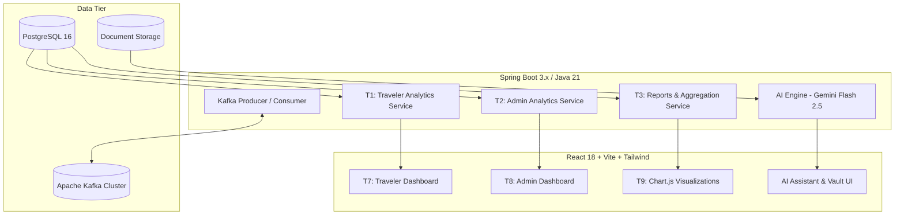

# TripNest — Technical Design Document & Milestone 4 Master Blueprint (`planningM4.md`)

**Document Version:** 4.0.0 (Milestone 4 — Full Stack Analytics, AI Suite, Kafka & Deployment)  
**Author:** Shreyas (Lead Engineer) & Antigravity (AI Pair Programmer)  
**Project Base Path:** `TripNestProjVer4M4` (`code_Backend` & `code_FrontEnd`)  
**Target Database:** PostgreSQL 16 (`tripnestdb2ag` / Supabase / Neon Cloud)  
**Scope Reference:** Milestone 4 Master Plan (Tasks 1 to 12 + Extended AI/Kafka Architecture)

---

## Executive Summary & Milestone 4 Vision

Milestones 1 through 3 established the core foundation of TripNest:
* **Milestone 1:** Authentication, User Profiles, JWT Security, and Base Architecture.
* **Milestone 2:** Trip Management, Day-by-Day Itinerary Engine, Activity Scheduling, and Destinations.
* **Milestone 3:** Financial Budgeting, Expense Tracking, Group Squads, Min-Cash-Flow Debt Settlement, and Document Locker.

**Milestone 4 elevates TripNest from a transactional travel app into an intelligent, data-driven, production-deployed Travel Intelligence Platform.** It is organized across two major tracks:

```text
┌────────────────────────────────────────────────────────────────────────────────────────┐
│                                MILESTONE 4 MASTER TRACKS                               │
├───────────────────────────────────────────┬────────────────────────────────────────────┤
│           BACKEND TRACK (Tasks 1 – 6)     │         FRONTEND TRACK (Tasks 7 – 12)      │
│  • Traveler Analytics APIs (T1)           │  • Traveler Analytics Dashboard (T7)       │
│  • Admin Analytics APIs (T2)              │  • Admin Control Dashboard (T8)            │
│  • Reports & Aggregation Engine (T3)      │  • Charts & Reports UI via Chart.js (T9)   │
│  • Backend Testing: JUnit/Mockito (T4)    │  • Frontend Testing: RTL & E2E (T10)       │
│  • Security & Query Optimization (T5)     │  • Performance Tuning & Production (T11)   │
│  • Backend Deployment & DevOps (T6)       │  • Final Integration & Vercel Deploy (T12) │
├───────────────────────────────────────────┴────────────────────────────────────────────┤
│                                EXTENDED ADVANCED MODULES                               │
│  • AI Suite: Chatbot, Itinerary Gen, Packing List, Receipt OCR, AI Vault Agent         │
│  • Event-Driven Streaming: Apache Kafka for Async OCR Processing & Budget Alerts       │
│  • Containerization: Multi-stage Dockerfiles & Docker Compose Orchestration            │
└────────────────────────────────────────────────────────────────────────────────────────┘
```

---

# PART 1: EVALUATOR & STAKEHOLDER OVERVIEW

### Why Milestone 4 Matters
When travelers return from trips or administrators run a travel platform, raw database rows are meaningless without **actionable analytics**:
1. **Traveler Financial Visibility:** Travelers need instant answers: *"How much have I spent this year across trips?"*, *"Am I staying under budget in Food vs Hotels?"*, and *"Which destinations do I visit most?"*.
2. **Platform Administrator Telemetry:** Admins need high-level metrics: user growth, booking frequency, platform transaction volumes, and destination popularity trends.
3. **Smart Automation (AI Suite):** Removing manual labor through automated packing suggestions, AI itinerary generation, receipt OCR extraction, and document summarization.
4. **Resilient Production Deployment:** Live cloud availability on Render and Vercel with HTTPS/SSL, zero downtime, and robust performance.

---

# PART 2: DETAILED TECHNICAL DESIGN (TASKS 1 TO 12)



---

## ── BACKEND ARCHITECTURE & SPECIFICATIONS (TASKS 1 – 6) ──

### 📌 Task 1: Traveler Analytics APIs
* **Purpose:** Delivers real-time personal metrics for the logged-in traveler.
* **Core Endpoints:**
  * `GET /api/analytics/traveler/summary`: High-level cards (Total trips, Upcoming trips count, Completed trips, Total spent, Active budget).
  * `GET /api/analytics/traveler/budget-vs-actual`: Compares allocated budgets vs logged expenses across all user trips.
  * `GET /api/analytics/traveler/category-spending`: Aggregates user expenses grouped by category (`FOOD`, `ACCOMMODATION`, `TRANSPORTATION`, `ACTIVITIES`, `SHOPPING`, `MISC`).
  * `GET /api/analytics/traveler/favorite-destinations`: Top visited destinations derived from user's completed trips with frequency counts.
  * `GET /api/analytics/traveler/monthly-trends`: Month-by-month spending trends for the past 12 months.
* **Key Java Classes:**
  * `TravelerAnalyticsService`
  * `TravelerAnalyticsController`
  * DTOs: `TravelerSummaryDTO`, `CategorySpendingDTO`, `BudgetVsActualDTO`, `FavoriteDestinationDTO`.

---

### 📌 Task 2: Admin Analytics APIs
* **Purpose:** Global telemetry for platform administrators (`ROLE_ADMIN`).
* **Security Guard:** Enforces `@PreAuthorize("hasRole('ADMIN')")`.
* **Core Endpoints:**
  * `GET /api/admin/analytics/overview`: Platform-wide stats (Total Users, Active Trips, Total Platform Spends, Average Trip Budget).
  * `GET /api/admin/analytics/user-growth`: User registration velocity (Daily/Weekly/Monthly signups).
  * `GET /api/admin/analytics/destination-trends`: Top trending destinations platform-wide.
  * `GET /api/admin/analytics/trip-distribution`: Categorization of trips by status (`PLANNED`, `ONGOING`, `COMPLETED`, `CANCELLED`).
  * `GET /api/admin/analytics/financial-aggregates`: Total system turnover, average budget per traveler.
* **Key Java Classes:**
  * `AdminAnalyticsService`
  * `AdminAnalyticsController`
  * DTOs: `AdminOverviewDTO`, `UserGrowthDTO`, `DestinationTrendDTO`, `PlatformFinancialsDTO`.

---

### 📌 Task 3: Reports & Data Aggregation APIs
* **Purpose:** Pre-calculates datasets tailored specifically for frontend Chart.js components and CSV/PDF export.
* **Core Endpoints:**
  * `GET /api/reports/trip/{tripId}/financial-summary`: Complete financial balance sheet for a single trip.
  * `GET /api/reports/expenses/export?format=csv`: Streams a structured CSV file of filtered expenses.
  * `GET /api/reports/travel-summary?year=2026`: Year-in-review travel statistics.
* **Key Java Classes:**
  * `ReportAggregationService`
  * `ReportController`
  * DTOs: `TripReportDTO`, `ChartDataSeriesDTO`.

---

### 📌 Task 4: Backend Testing & Validation (Deferred for Post-MVP)
* **Purpose:** Comprehensive test suite guaranteeing code stability.
* **Scope:**
  * Unit tests with **JUnit 5** and **Mockito** for `TravelerAnalyticsService`, `AdminAnalyticsService`, `ExpenseService`, and `MinCashFlowService`.
  * Integration tests with `@WebMvcTest` validating security filters, JWT extraction, and input validation annotations.
  * Postman collection generation for automated regression test runs.

---

### 📌 Task 5: Security & Performance Optimization (Deferred for Post-MVP)
* **Scope:**
  * Database indexing: Compound indices on `expenses(trip_id, category)` and `trips(user_id, status)`.
  * Query optimization: Eliminating $N+1$ query issues via JPA `@EntityGraph` and native aggregation queries.
  * Security audits: Rate limiting on public endpoints and XSS/SQL injection prevention validation.

---

### 📌 Task 6: Backend Deployment & Production Configuration
* **Scope:**
  * Production profile: `application-prod.yml` with environment-driven database credentials.
  * Cloud hosting on **Render** (as a native Web Service or Docker container).
  * Managed PostgreSQL on **Supabase** or **Neon**.
  * SSL/HTTPS termination and CORS configuration for Vercel domains.

---

## ── FRONTEND ARCHITECTURE & SPECIFICATIONS (TASKS 7 – 12) ──

### 📌 Task 7: Traveler Analytics Dashboard
* **Route:** `/dashboard/traveler`
* **Components:**
  * `MetricCards.jsx`: 4 metric cards (Active Trips, Total Spent, Remaining Budget, Favorite Spot).
  * `UpcomingTripCard.jsx`: Countdown badge, destination hero banner, itinerary shortcut.
  * `RecentExpensesWidget.jsx`: Quick table showing last 5 transactions with category icons.

---

### 📌 Task 8: Admin Dashboard
* **Route:** `/admin/dashboard`
* **Components:**
  * `AdminStatCards.jsx`: Platform totals with percentage change badges.
  * `UserActivityTable.jsx`: Real-time user signups and last active session dates.
  * `SystemHealthBadge.jsx`: API status, database latency, and storage availability.

---

### 📌 Task 9: Charts & Visual Reports UI (Chart.js)
* **Library:** `react-chartjs-2` + `chart.js`
* **Visualizations:**
  1. **Donut / Pie Chart:** Expense breakdown by category (`Food`, `Stay`, `Transport`, etc.).
  2. **Grouped Bar Chart:** Allocated Budget vs Actual Spent per trip.
  3. **Line Chart:** 12-Month historical spending progression.
  4. **Polar / Radar Chart:** Travel style preferences (Adventure, Luxury, Budget, Nature).

---

### 📌 Task 10: Frontend Testing & Validation (Deferred for Post-MVP)
* **Tooling:** React Testing Library + Vitest / Jest.
* **Scope:**
  * Testing Chart components rendering with empty vs populated data.
  * Testing auth state redirection (Traveler vs Admin routes).
  * End-to-end user navigation flows.

---

### 📌 Task 11: Frontend Optimization & Production Setup (Deferred for Post-MVP)
* **Scope:**
  * Code splitting via `React.lazy()` for Analytics and Admin dashboards.
  * Asset compression and bundle size auditing using Vite analyzer.
  * Production environment variables (`VITE_API_BASE_URL`).

---

### 📌 Task 12: Final Integration & Deployment
* **Platform:** **Vercel** (Hobby Tier - Free).
* **Setup:**
  * Connect frontend GitHub repository.
  * Zero-config static build pipeline (`npm run build`).
  * Automatic HTTPS, global CDN edge network, and environment variable synchronization with Render backend.

---

# PART 3: ADVANCED EXTENSION MODULES

### 🤖 Module A: AI Features Suite (Powered by Google Gemini 2.5 Flash)
1. **AI Travel Chatbot:** Context-aware virtual travel guide integrated with TripNest itinerary data.
2. **AI Itinerary Generator:** Creates multi-day custom travel plans in structured JSON from destination, budget, and travel style inputs.
3. **AI Packing List Generator:** Generates categorized packing checklists based on destination climate, trip duration, and planned activities.
4. **AI Receipt OCR & Auto-Expense Extraction:** Multimodal image extraction from receipts/invoices into pre-filled expense forms.
5. **AI Vault Agent:** Summarizes boarding passes, hotel reservations, and ticket PDFs into structured metadata cards.

---

### ⚡ Module B: Event-Driven Architecture (Apache Kafka)
* **Use Case 1 (Async AI Document Extraction):** Offloads heavy AI PDF/Image OCR processing from the HTTP request thread into a Kafka event queue (`vault-document-uploads`), notifying the client upon completion.
* **Use Case 2 (Budget Threshold Alerts):** Emits `budget-breached-events` when expenses reach 90% or 100% of allocation, triggering asynchronous notification pipelines.

---

### 🐳 Module C: Containerization (Docker)
* Multi-stage build for Spring Boot backend (`maven:3.9` $\rightarrow$ `eclipse-temurin:17-jre-alpine`).
* Multi-stage build for React frontend (`node:20-alpine` $\rightarrow$ `nginx:alpine`).
* Unified `docker-compose.yml` orchestrating Backend, Frontend, PostgreSQL, and Kafka.

---

# PART 4: COMPLETE REST API ENDPOINT CONTRACT (M4)

| Task | HTTP Method | Endpoint Path | Access Level | Description |
|---|---|---|---|---|
| **T1** | `GET` | `/api/analytics/traveler/summary` | Authenticated | Traveler KPI cards (trips, spends, budgets) |
| **T1** | `GET` | `/api/analytics/traveler/budget-vs-actual` | Authenticated | Comparison data of budget ceilings vs actual expenses |
| **T1** | `GET` | `/api/analytics/traveler/category-spending` | Authenticated | Expense distribution across 6 categories |
| **T1** | `GET` | `/api/analytics/traveler/favorite-destinations`| Authenticated | Top visited destinations with frequency |
| **T1** | `GET` | `/api/analytics/traveler/monthly-trends` | Authenticated | 12-month rolling expenditure trends |
| **T2** | `GET` | `/api/admin/analytics/overview` | `ROLE_ADMIN` | Platform-wide macro KPIs |
| **T2** | `GET` | `/api/admin/analytics/user-growth` | `ROLE_ADMIN` | User registration velocity over time |
| **T2** | `GET` | `/api/admin/analytics/destination-trends` | `ROLE_ADMIN` | Top global travel destinations booked |
| **T2** | `GET` | `/api/admin/analytics/trip-distribution` | `ROLE_ADMIN` | Status breakdown of all platform trips |
| **T3** | `GET` | `/api/reports/trip/{tripId}/summary` | Authenticated | Detailed financial audit for single trip |
| **T3** | `GET` | `/api/reports/expenses/export` | Authenticated | CSV export for trip expenses |
| **AI** | `POST`| `/api/ai/chat` | Authenticated | Multiturn AI assistant prompt |
| **AI** | `POST`| `/api/ai/generate-itinerary` | Authenticated | Automated day-by-day JSON itinerary |
| **AI** | `POST`| `/api/ai/packing-list` | Authenticated | Categorized gear checklist |
| **AI** | `POST`| `/api/ai/ocr-expense` | Authenticated | Image/PDF receipt data extraction |
| **AI** | `POST`| `/api/ai/vault-summary` | Authenticated | Ticket/Document summary extraction |

---

# PART 5: PHASED EXECUTION ROADMAP

```text
PHASE 1: Core Analytics & Reporting (M4 Tasks 1, 2, 3) ──> CURRENT FOCUS
PHASE 2: Frontend Dashboards & Chart.js (M4 Tasks 7, 8, 9)
PHASE 3: AI Travel Suite (Gemini Flash Multimodal)
PHASE 4: Apache Kafka Event Streaming
PHASE 5: First Cloud Deployment (Render Native + Vercel Static + Supabase DB)
PHASE 6: Dockerization & Testing (Tasks 4, 5, 6, 10, 11)
```
