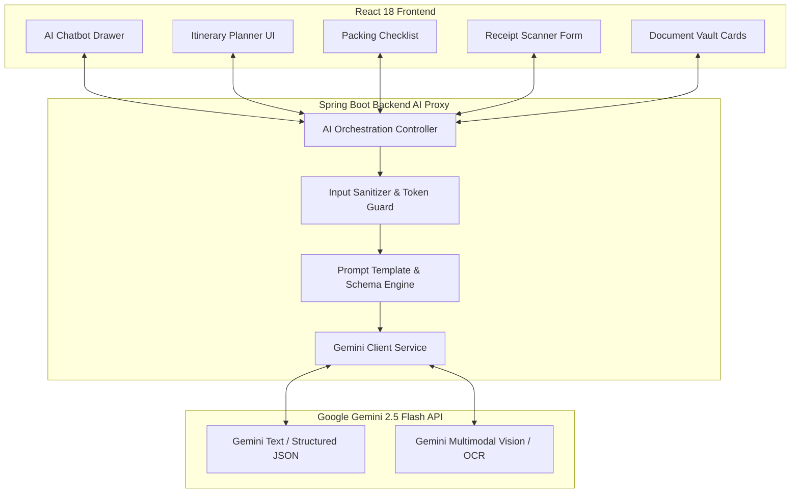

# TripNest — Technical Design Document & Milestone 5 Blueprint (`planningM5.md`)

**Document Version:** 5.0.0 (Milestone 5 — Generative AI Travel Suite & Intelligent Agents)  
**Author:** Shreyas (Lead Engineer) & Antigravity (AI Pair Programmer)  
**Project Base Path:** `TripNestProjVer4M4` (`code_Backend` & `code_FrontEnd`)  
**Target Engine:** Google Gemini API (`gemini-2.5-flash` / Multimodal Vision & Document Processing)  
**Scope Reference:** Milestone 5 Advanced Scope (AI Chatbot, Itinerary Engine, Packing Assistant, Receipt OCR, AI Vault Agent)

---

## Executive Summary & Milestone 5 Vision

Milestone 5 transforms TripNest from a standard travel management system into an **Intelligent Autonomous Travel Companion**. By integrating Google Gemini's multimodal reasoning, TripNest eliminates manual data entry, provides instant travel intelligence, and personalizes vacations using generative AI.

```text
┌────────────────────────────────────────────────────────────────────────────────────────┐
│                              TRIPNEST M5 AI SUITE ENGINE                               │
├────────────────────────────────────────────────────────────────────────────────────────┤
│ 1. AI TRAVEL CHATBOT      │ Context-aware multi-turn conversational travel assistant.  │
│ 2. AI ITINERARY GENERATOR │ Destination + Budget + Days ──> Structured day-by-day JSON │
│ 3. AI PACKING ASSISTANT   │ Climate + Duration + Activity ──> Categorized checklists.  │
│ 4. AI RECEIPT OCR         │ Receipt photo/PDF ──> Auto-extract merchant, amount, date. │
│ 5. AI VAULT AGENT         │ Boarding pass/ticket PDF ──> Structured summary cards.     │
└────────────────────────────────────────────────────────────────────────────────────────┘
```

---

# PART 1: THE 5 CORE AI MODULES



---

### 📌 Module 1: AI Travel Chatbot (Context-Aware Guide)

* **Objective:** Acts as an on-demand local tour guide and trip advisor.
* **Context Injection:** When invoked from within an active trip, the backend automatically injects trip details (Destination: *"Goa"*, Budget: *"₹30,000"*, Travel Dates: *"Nov 10–15"*) into the system prompt.
* **System Prompt:**
  ```text
  You are 'Nestie', the intelligent AI travel companion for TripNest.
  You give concise, actionable, and personalized travel tips, local food recommendations,
  hidden gems, and budget-friendly advice. Always reply in formatted markdown.
  ```
* **Payload Structure (`/api/ai/chat`):**
  * **Request:** `{ "tripId": 14, "message": "What are top 3 vegetarian breakfast places near Anjuna beach?" }`
  * **Response:** `{ "reply": "...", "suggestedFollowUps": ["Best time to visit", "Estimated taxi fare"] }`

---

### 📌 Module 2: AI Itinerary Generator (Auto-Trip Planner)

* **Objective:** Generates an end-to-end multi-day itinerary in **strict JSON format** that can be directly converted into database records.
* **Input Parameters:**
  * `destination`: String (e.g., *"Manali, Himachal Pradesh"*)
  * `durationDays`: Integer (e.g., `4`)
  * `budgetTier`: Enum (`BUDGET`, `MODERATE`, `LUXURY`)
  * `interests`: List (`ADVENTURE`, `FOOD`, `NATURE`, `HERITAGE`)
* **Strict JSON Response Schema:**
  ```json
  {
    "tripTitle": "4-Day Scenic Manali Adventure",
    "days": [
      {
        "dayNumber": 1,
        "theme": "Local Old Manali & Cafes",
        "activities": [
          {
            "timeSlot": "09:30 AM",
            "title": "Visit Hadimba Temple",
            "description": "Historic wooden temple surrounded by cedar forest.",
            "estimatedCost": 100,
            "category": "ACTIVITIES"
          }
        ]
      }
    ]
  }
  ```
* **"1-Click Save to My Trips" Workflow:**
  * When the user clicks **"Apply to Itinerary"**, the backend automatically creates `ItineraryDay` and `Activity` records in PostgreSQL.

---

### 📌 Module 3: AI Packing List Generator

* **Objective:** Removes forgotten essentials by dynamically generating packing lists based on real-world constraints.
* **Input Parameters:** `destination`, `startDate`, `durationDays`, `activities` (e.g., *"Trekking, Swimming"*), `travelersCount`.
* **Output Categories:**
  * `Clothing` (weather-appropriate apparel)
  * `Toiletries & Hygiene`
  * `Electronics & Gadgets` (adapters, power banks)
  * `Travel Documents & Medicine` (permits, motion sickness pills)
* **Interactive UI:** Checkboxes persist state in browser `localStorage` or backend so travelers can cross off packed items while packing their bags.

---

### 📌 Module 4: AI Receipt OCR & Auto-Expense Extraction

* **Objective:** Eliminates manual receipt entry. Travelers photograph paper bills or upload digital invoices, and the AI extracts financial entities.
* **Multimodal Vision Architecture:**
  * Accepts `multipart/form-data` (JPEG, PNG, WEBP, or PDF).
  * Encodes image to Base64 and invokes Gemini Vision with structured schema extraction.
* **Extracted JSON Schema:**
  ```json
  {
    "merchantName": "Cafe Lilliput",
    "totalAmount": 1450.00,
    "currency": "INR",
    "expenseDate": "2026-11-12",
    "category": "FOOD",
    "confidenceScore": 0.96
  }
  ```
* **Frontend Integration:** Directly populates the **"Add Expense"** modal fields, allowing the user to review and click **"Save Expense"** in 2 seconds.

---

### 📌 Module 5: AI Vault Agent (Ticket & Bill Summarizer)

* **Objective:** Automatically analyzes uploaded travel vouchers (Flight boarding passes, IRCTC train tickets, hotel reservation PDFs) and generates concise summary cards.
* **Extracted Entities:**
  * **Flight:** Airline, Flight No, PNR, Origin $\rightarrow$ Destination, Terminal/Gate, Boarding Time, Seat.
  * **Hotel:** Hotel Name, Booking Reference, Check-in / Check-out Dates, Room Type, Address.
  * **Train:** Train No/Name, PNR, Coach/Berth, Departure Platform.
* **Vault UI Widget:** Renders an attractive "Boarding Pass" style preview card at the top of the Document Locker, highlighting critical departure times and PNR codes without opening 5-page PDF files.

---

# PART 2: REST API ENDPOINTS CONTRACT (M5)

| HTTP Method | Endpoint Path | Access Level | Description |
|---|---|---|---|
| `POST` | `/api/ai/chat` | Authenticated | Multi-turn conversational travel assistant |
| `POST` | `/api/ai/generate-itinerary` | Authenticated | Generates structured multi-day JSON itinerary |
| `POST` | `/api/ai/save-generated-itinerary` | Authenticated | Persists AI itinerary directly into database |
| `POST` | `/api/ai/generate-packing-list` | Authenticated | Creates categorized packing checklist |
| `POST` | `/api/ai/ocr/receipt` | Authenticated | Multimodal OCR parsing of receipt image/PDF |
| `POST` | `/api/ai/vault/summarize-document` | Authenticated | Extracts structured travel details from vouchers |

---

# PART 3: PRODUCTION RESILIENCE & API KEY SAFETY

1. **Zero Client Leakage:** The Gemini API key is stored strictly on the Spring Boot backend (`GEMINI_API_KEY` environment variable). The frontend **never** interacts directly with Google APIs.
2. **Rate Limiting & Cost Guard:** 
   * Maximum 15 AI requests per user per hour to prevent quota exhaustion on free tiers.
   * Prompts enforce `max_output_tokens: 1500` to ensure snappy response times (< 2 seconds).
3. **Structured JSON Validation:**
   * Gemini `response_mime_type: "application/json"` ensures reliable JSON responses without markdown backticks breaking frontend JSON parsers.
4. **Fallback Mechanism:**
   * If Gemini API experiences network timeouts, clean graceful degradation DTOs are returned with user-friendly error banners.
