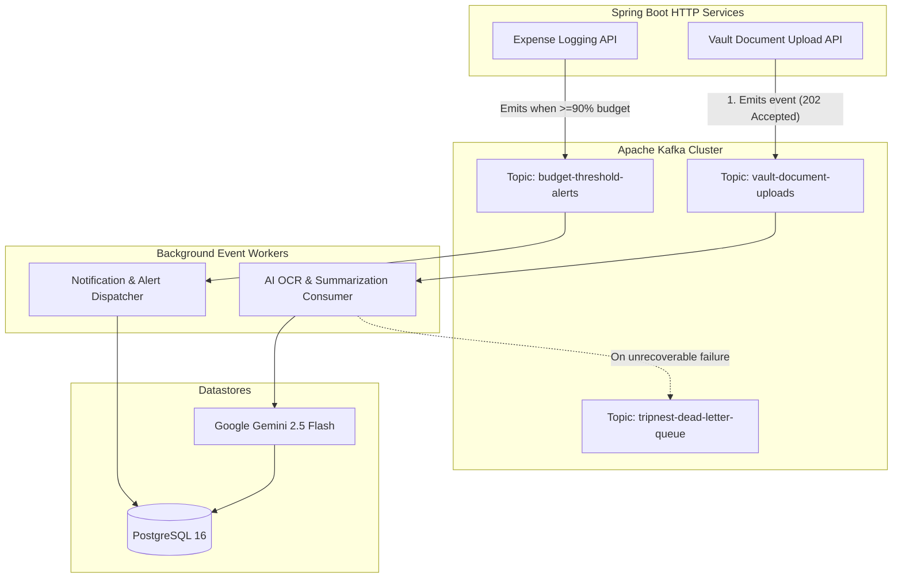

# TripNest — Technical Design Document & Milestone 6 Blueprint (`planningM6.md`)

**Document Version:** 6.0.0 (Milestone 6 — Apache Kafka Event Streaming & Docker Containerization)  
**Author:** Shreyas (Lead Engineer) & Antigravity (AI Pair Programmer)  
**Project Base Path:** `TripNestProjVer4M4` (`code_Backend` & `code_FrontEnd`)  
**Target Infrastructure:** Apache Kafka (Local KRaft / Upstash Cloud), Docker, Docker Compose, Render, Vercel  
**Scope Reference:** Milestone 6 Advanced Architecture (Event Streaming & Containerization)

---

## Executive Summary & Milestone 6 Vision

As TripNest scales to support complex generative AI workloads, high-frequency expense tracking, and group notifications, synchronous request-response HTTP architectures begin to suffer from latency bottlenecks and thread starvation. 

**Milestone 6 achieves two major enterprise milestones:**
1. **Event-Driven Architecture with Apache Kafka:** Decouples long-running AI document parsing and automated budget notification dispatchers into high-throughput asynchronous event streams.
2. **Production Containerization with Docker:** Packages backend, frontend, database, and message brokers into standardized, lightweight containers for repeatable local testing and seamless cloud deployment.

---

# PART 1: APACHE KAFKA EVENT STREAMING ARCHITECTURE



---

### 📌 Core Kafka Use Case 1: Asynchronous AI Vault Processing

#### The Problem:
Multimodal AI document OCR and PDF summarization (via Gemini Vision) takes **3 to 6 seconds** per document. In a traditional synchronous HTTP model:
* The user's browser hangs on a loading spinner.
* Spring Boot Tomcat request worker threads remain blocked.
* Slow mobile connections encounter HTTP `504 Gateway Timeout`.

#### The Kafka Solution:
1. User uploads a boarding pass or ticket PDF via `POST /api/trips/{id}/documents/async-upload`.
2. The controller validates file headers, saves the file to disk/storage, publishes an event to Kafka topic `vault-document-uploads`, and immediately returns **`202 Accepted`** with a job tracking ID.
3. The frontend updates UI state to *"Processing in Background..."*.
4. `VaultDocumentConsumer` picks up the message, invokes Gemini API, extracts metadata, updates PostgreSQL, and sets status to `READY`.

#### Event Payload Schema (`vault-document-uploads`):
```json
{
  "eventId": "evt_987654321",
  "documentId": 45,
  "tripId": 14,
  "userId": 2,
  "storagePath": "uploads/vault/flight_ticket_14.pdf",
  "mimeType": "application/pdf",
  "timestamp": "2026-10-16T10:30:00Z"
}
```

---

### 📌 Core Kafka Use Case 2: Real-Time Budget Threshold Alerts

#### The Problem:
Checking budget ceilings, calculating category utilization, creating in-app notification rows, and dispatching alert emails on every single expense entry degrades write throughput on high-traffic trips.

#### The Kafka Solution:
1. When an expense is recorded, `ExpenseService` checks if current spending crosses **90%** or **100%** of budget allocation.
2. If breached, it asynchronously emits a `BudgetAlertEvent` to topic `budget-threshold-alerts`.
3. `BudgetNotificationConsumer` handles notification persistence, deduplication (ensuring user isn't spammed for multiple small expenses over the limit), and downstream alert routing.

---

### Kafka Infrastructure: Local vs Free Cloud Setup

| Parameter | Local Development | Production Free Cloud |
|---|---|---|
| **Engine** | Dockerized Kafka (KRaft mode - no Zookeeper required) | **[Upstash Kafka](https://upstash.com/kafka)** (Serverless) |
| **Connection Protocol** | Plaintext `localhost:9092` | SASL_SSL with SCRAM-SHA-256 |
| **Cost** | Free (Local resources) | 100% Free (10,000 messages/day) |

---

# PART 2: DOCKER CONTAINERIZATION ARCHITECTURE

Containerizing TripNest ensures identical behavior between development laptops and cloud servers while isolating runtimes.

```text
┌────────────────────────────────────────────────────────────────────────┐
│                        TRIPNEST DOCKER ECOSYSTEM                       │
├────────────────────┬────────────────────┬──────────────────────────────┤
│ 1. BACKEND IMAGE   │ 2. FRONTEND IMAGE  │ 3. DOCKER COMPOSE            │
│ Multi-stage Maven  │ Multi-stage Node   │ Single command orchestration │
│ + Temurin 17 JRE   │ + Nginx Alpine     │ `docker compose up -d`       │
└────────────────────┴────────────────────┴──────────────────────────────┘
```

---

### 1. Spring Boot Multi-Stage `Dockerfile`
Designed to minimize image size and configure JVM memory flags for low-cost cloud environments:

```dockerfile
# Stage 1: Build JAR with Maven
FROM maven:3.9-eclipse-temurin-17-alpine AS builder
WORKDIR /app
COPY pom.xml .
RUN mvn dependency:go-offline -B
COPY src ./src
RUN mvn clean package -DskipTests

# Stage 2: Ultra-light JRE Runtime
FROM eclipse-temurin:17-jre-alpine
WORKDIR /app
RUN addgroup -S tripnest && adduser -S tripnest -G tripnest
USER tripnest

COPY --from=builder /app/target/*.jar app.jar

# JVM Memory Tuning: Prevent OOM on Render free tier (512MB RAM limit)
ENV JAVA_OPTS="-XX:MaxRAMPercentage=75.0 -XX:+UseG1GC"

EXPOSE 8080
ENTRYPOINT ["sh", "-c", "java $JAVA_OPTS -jar app.jar"]
```

---

### 2. React + Vite Multi-Stage `Dockerfile`
Compiles static JavaScript assets and serves them via ultra-fast, lightweight Nginx:

```dockerfile
# Stage 1: Build React Production Bundle
FROM node:20-alpine AS builder
WORKDIR /app
COPY package*.json ./
RUN npm ci
COPY . .
RUN npm run build

# Stage 2: Nginx Production Web Server
FROM nginx:alpine
COPY --from=builder /app/dist /usr/share/nginx/html
COPY nginx.conf /etc/nginx/conf.d/default.conf

EXPOSE 80
CMD ["nginx", "-g", "daemon off;"]
```

---

### 3. Unified `docker-compose.yml`
Enables one-command spin up of the complete TripNest platform:

```yaml
version: '3.8'

services:
  tripnest-db:
    image: postgres:16-alpine
    container_name: tripnest_postgres
    environment:
      POSTGRES_DB: tripnestdb
      POSTGRES_USER: tripnest_user
      POSTGRES_PASSWORD: tripnest_password
    ports:
      - "5432:5432"
    volumes:
      - pgdata:/var/lib/postgresql/data
    healthcheck:
      test: ["CMD-SHELL", "pg_isready -U tripnest_user -d tripnestdb"]
      interval: 10s
      timeout: 5s
      retries: 5

  kafka:
    image: bashj79/kafka-kraft:latest
    container_name: tripnest_kafka
    ports:
      - "9092:9092"
    environment:
      KAFKA_CFG_NODE_ID: 1
      KAFKA_CFG_PROCESS_ROLES: broker,controller
      KAFKA_CFG_LISTENERS: PLAINTEXT://:9092,CONTROLLER://:9093
      KAFKA_CFG_LISTENER_SECURITY_PROTOCOL_MAP: CONTROLLER:PLAINTEXT,PLAINTEXT:PLAINTEXT
      KAFKA_CFG_CONTROLLER_LISTENER_NAMES: CONTROLLER
      KAFKA_CFG_CONTROLLER_QUORUM_VOTERS: 1@localhost:9093

  tripnest-backend:
    build:
      context: ./code_Backend
      dockerfile: Dockerfile
    container_name: tripnest_backend
    ports:
      - "8080:8080"
    environment:
      SPRING_DATASOURCE_URL: jdbc:postgresql://tripnest-db:5432/tripnestdb
      SPRING_DATASOURCE_USERNAME: tripnest_user
      SPRING_DATASOURCE_PASSWORD: tripnest_password
      SPRING_KAFKA_BOOTSTRAP_SERVERS: kafka:9092
    depends_on:
      tripnest-db:
        condition: service_healthy

  tripnest-frontend:
    build:
      context: ./code_FrontEnd
      dockerfile: Dockerfile
    container_name: tripnest_frontend
    ports:
      - "3000:80"
    depends_on:
      - tripnest-backend

volumes:
  pgdata:
```

---

# PART 3: CLOUD DEPLOYMENT BLUEPRINT (RENDER & VERCEL)

1. **Phase 1 (Learn Native Deployment):**
   * Backend: Render Native Java Web Service (`mvn clean package -DskipTests`).
   * Frontend: Vercel Static Edge Deploy (connect Git repo $\rightarrow$ automatic build).
   * Database: Supabase or Neon Cloud PostgreSQL.
2. **Phase 2 (Upgrade to Dockerized Deployment):**
   * Change Render Environment from "Native" to "Docker".
   * Render automatically builds the multi-stage `Dockerfile` from the repository root.
   * Free limits remain 100% compliant (uses < 20% of free hours and build minutes).
