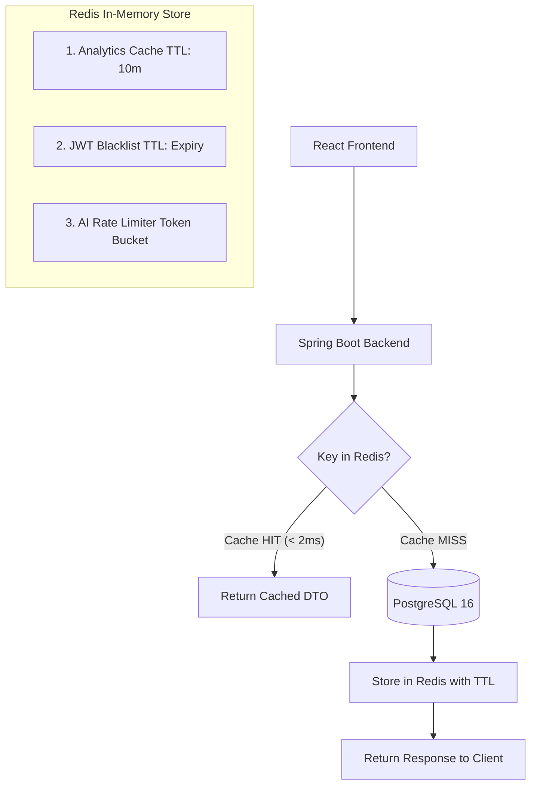
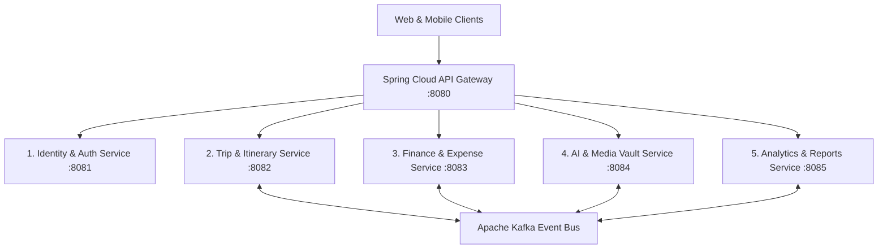

# TripNest — Technical Design Document & Milestone 7 Blueprint (`planningM7.md`)

**Document Version:** 7.0.0 (Milestone 7 — Redis Caching, Performance & Microservices Transition)  
**Author:** Shreyas (Lead Engineer) & Antigravity (AI Pair Programmer)  
**Project Base Path:** `TripNestProjVer4M4` (`code_Backend` & `code_FrontEnd`)  
**Target Architecture:** Redis In-Memory Datastore, Spring Cloud Gateway, Microservices Decomposition  
**Status:** Optional / Advanced Architectural Track (Future-Proofing & System Scaling)

---

## Executive Summary & Milestone 7 Vision

While a monolithic Spring Boot architecture serves early-stage platforms exceptionally well, high-scale travel platforms encounter database read contention on analytics queries, token invalidation challenges in stateless authentication, and organizational scaling limits.

**Milestone 7 outlines the enterprise evolution of TripNest:**
1. **Redis In-Memory Performance Layer:** Sub-millisecond distributed caching, stateless JWT token blacklisting, and distributed API rate-limiting.
2. **Microservices Decomposition Blueprint:** Step-by-step strategy for decoupling TripNest into 5 independently deployable microservices orchestrated by an API Gateway and Apache Kafka.

---

# PART 1: REDIS IN-MEMORY INTEGRATION ARCHITECTURE



---

### 📌 Redis Use Case 1: High-Performance Analytics Caching

#### The Problem:
`TravelerDashboardSummaryDTO` and `AdminOverviewDTO` execute complex SQL aggregations (`SUM()`, `COUNT()`, `GROUP BY`, CTEs). If 1,000 users refresh their dashboard simultaneously, PostgreSQL CPU spikes under repetitive aggregation calculations.

#### The Redis Solution:
* Cache analytics payloads in Redis using `@Cacheable` with a **10-minute Time-To-Live (TTL)**.
* **Cache Eviction (`@CacheEvict`):** Whenever a user creates, edits, or deletes an expense or trip, the corresponding Redis key (`traveler_analytics::{userId}`) is instantly purged, guaranteeing read consistency.

```java
@Service
public class TravelerAnalyticsService {

    @Cacheable(value = "traveler_analytics", key = "#userId")
    public TravelerDashboardSummaryDTO getTravelerDashboardSummary(Long userId) {
        // Heavy SQL aggregation executed ONLY on cache miss
        return computeDashboardStats(userId);
    }

    @CacheEvict(value = "traveler_analytics", key = "#userId")
    public void evictTravelerCache(Long userId) {
        // Triggered automatically on new expense or trip modification
    }
}
```

---

### 📌 Redis Use Case 2: Instant JWT Blacklisting & Logout Invalidation

#### The Problem:
Stateless JWTs cannot be revoked before their expiration timestamp without querying a database on every single API request, which defeats the purpose of stateless authentication.

#### The Redis Solution:
* Upon calling `POST /api/auth/logout`, the JWT is stored in Redis with key `blacklist:{token}`.
* The TTL is set exactly to the token's remaining validity duration (e.g., 45 minutes).
* `JwtAuthenticationFilter` executes a lightning-fast `redisTemplate.hasKey()` check (< 1ms). If blacklisted, the request is immediately rejected with `401 Unauthorized`.

---

### 📌 Redis Use Case 3: Distributed Rate-Limiting for Generative AI

#### The Problem:
OpenAI / Google Gemini APIs have usage quotas and cost implications. Malicious users or rapid clicking could exhaust API quotas.

#### The Redis Solution:
* Implements a **Sliding Window Token Bucket** algorithm in Redis.
* Rate key: `ratelimit:ai:{userId}`.
* Enforces limit: **Maximum 15 AI requests per user per hour**. Requests exceeding the limit return `429 Too Many Requests` with a `Retry-After` header.

---

# PART 2: MICROSERVICES TRANSITION BLUEPRINT

When transitioning from the current modular monolith into distributed microservices, TripNest decomposes into **5 bounded contexts**:



---

### The 5 Microservice Bounded Contexts

| Microservice | Port | Domain Responsibilities | Database |
|---|:---:|---|---|
| **Identity Service** | `8081` | User registration, login, JWT issuance, roles, profile management. | `users_db` (PostgreSQL) + Redis |
| **Trip & Itinerary Service** | `8082` | Trip CRUD, destination catalog, day-by-day itineraries, activities. | `trips_db` (PostgreSQL) |
| **Finance Service** | `8083` | Budgets, expense tracking, group splitting, Min-Cash-Flow settlements. | `finance_db` (PostgreSQL) |
| **AI & Media Vault Service** | `8084` | Gemini AI chatbot, itinerary generator, receipt OCR, document storage. | `vault_db` + Cloud Storage |
| **Analytics Service** | `8085` | Materialized views, user metrics, admin telemetry, CSV exports. | Read-Replicas + Redis |

---

### Core Distributed Systems Patterns

1. **API Gateway (Spring Cloud Gateway):**
   * Single entry point on port `8080`.
   * Centralizes SSL termination, CORS handling, JWT verification, and routing.
2. **Service Discovery (Netflix Eureka / Consul):**
   * Dynamically tracks healthy instances of microservices, enabling autoscaling without hardcoding IP addresses.
3. **Event-Driven Inter-Service Messaging:**
   * Instead of brittle synchronous HTTP calls between microservices, services communicate via Kafka events (e.g., `TripCreatedEvent`, `ExpenseLoggedEvent`).
4. **Distributed Tracing (Micrometer + Zipkin):**
   * Passes unique `traceId` and `spanId` across HTTP headers and Kafka records, enabling end-to-end debugging across microservices.

---

# PART 3: ARCHITECTURAL EVALUATION & DEFENSE MATRIX

For university thesis panels or corporate technical evaluations, having this document demonstrates **senior-level software architectural maturity**:

* **Why start Monolith-First?** Avoids premature distributed systems complexity (network latency, distributed transactions, 2PC) during early feature delivery (Milestones 1–4).
* **Why Redis?** Solves read-amplification on analytics dashboards and solves JWT revocation cleanly.
* **Why Kafka over RabbitMQ?** Kafka's persistent commit log allows multiple consumers (Analytics, Notifications, Audit) to replay events independently at their own pace.
